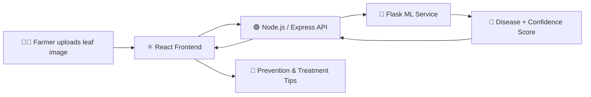

<!-- ===================== HEADER ===================== -->
<div align="center">


<a href="https://git.io/typing-svg">
  
</a>

<br/><br/>


<br/><br/>

<a href="https://sopanparnate-portfolio.online"></a>
<a href="https://www.linkedin.com/in/sopan-parnate"></a>
<a href="mailto:parnatesopan6@gmail.com"></a>

</div>

<br/>

<!-- ===================== SNAKE ===================== -->
<div align="center">
  <picture>
    <source media="(prefers-color-scheme: dark)" srcset="https://raw.githubusercontent.com/Sopanparnate/Sopanparnate/output/github-snake-dark.svg" />
    <source media="(prefers-color-scheme: light)" srcset="https://raw.githubusercontent.com/Sopanparnate/Sopanparnate/output/github-snake.svg" />
    
  </picture>
</div>

---

## 👨‍💻 About Me

<table>
<tr>
<td width="55%" valign="top">

I'm a Computer Science student and **MERN stack developer** who loves turning ideas into fast, clean and scalable web apps. With a **~9.0 CGPA**, I balance strong fundamentals with hands-on building: from live-contest platforms to AI-powered tools.

I care about **clean, maintainable code** and **experiences people actually enjoy using**. Right now I'm looking for a **Web Developer Internship** where I can contribute, learn and grow in a fast-paced team.

</td>
<td width="45%" valign="top">

```js
const sopan = {
  role: "Full-Stack Dev (MERN)",
  base: "Amaravati, India 🇮🇳",
  study: "B.E. CS @ PRMCEAM",
  building: "ForensiHash 🔐",
  learning: ["Spring Boot", "System Design"],
  seeking: "Web Dev Internship",
  available: "Immediately ✅",
};
```

</td>
</tr>
</table>

| | |
|---|---|
| 🔭 **Working on** | **ForensiHash** |
| 🌱 **Learning** | **Spring Boot** & **System Design** |
| 🎯 **Seeking** | Web Developer Internship (remote or on-site) |
| 🌐 **Portfolio** | [sopanparnate-portfolio.online](https://sopanparnate-portfolio.online) |
| 💼 **LinkedIn** | [linkedin.com/in/sopan-parnate](https://www.linkedin.com/in/sopan-parnate) |
| 📫 **Email** | [parnatesopan6@gmail.com](mailto:parnatesopan6@gmail.com) |

---

## ⚡ What I Bring

<div align="center">

| 🧱 Full-Stack Builds | ⚡ Real-Time Systems | 🤖 AI Integration | 🔐 Secure by Design |
|:---:|:---:|:---:|:---:|
| End-to-end MERN apps with REST APIs | Live leaderboards & updates with Socket.io | ML models served to React via Flask APIs | JWT, bcrypt & role-based access control |

</div>

---

## 🛠️ Tech Stack

<div align="center">

**🎨 Frontend**


**⚙️ Backend & Database**


**💬 Languages**


**🧰 Tools & Deployment**


**🌱 Also Exploring**


</div>

<details>
<summary><b>📋 View skills as a table</b></summary>
<br/>

| Category | Skills |
|---|---|
| **Frontend** | HTML5, CSS3, JavaScript (ES6+), React.js |
| **Backend** | Node.js, Express.js, REST APIs |
| **Database** | MongoDB |
| **Tools** | Git, GitHub, VS Code, Postman, Vercel, Render |
| **Languages** | JavaScript, Java (Core) |

</details>

---

## 🚀 Featured Projects

<table>
<tr>
<td width="50%" valign="top">

### 🏛️ SchemeSathi
*Helping citizens discover government schemes they're eligible for.*

- 🔎 Dynamic multi-filter search (state, category, income)
- 🔐 JWT + bcrypt authentication
- 📱 Responsive React UI with real-time filter updates


</td>
<td width="50%" valign="top">

### 💻 CodeZenith
*A competitive coding platform with live contests.*

- ⚡ Real-time leaderboard via Socket.io
- 🧪 Code editor with syntax highlighting & test-case validation
- 🛡️ Role-based access: admin vs participant


</td>
</tr>
<tr>
<td width="50%" valign="top">

### 🌱 AgriGuard
*AI-powered crop disease detection for farmers.*

- 🤖 Python/Flask ML model connected to a MERN frontend
- 📸 Image upload with live classification & confidence score
- 💊 Treatment tips for **10+ crop diseases**
- 👨‍🌾 Mobile-first UI for rural accessibility


</td>
<td width="50%" valign="top">

### 🔐 ForensiHash &nbsp; `🚧 In Progress`
*Digital evidence integrity tool built around hashing and verification.*

- *(Edit these bullets with your own details!)*


</td>
</tr>
</table>

<div align="center">

👉 **More projects, case studies & live demos:** [sopanparnate-portfolio.online](https://sopanparnate-portfolio.online)

</div>

<!-- Add [GitHub](repo-link) · [Live Demo](demo-link) links under each project when ready -->

### 🧩 How AgriGuard Works



---

## 🎓 Education

<table>
<tr>
<th>Qualification</th><th>Institute</th><th>Score</th><th>Year</th>
</tr>
<tr>
<td><b>B.E. Computer Science</b></td>
<td>PRMCEAM, Badnera, Maharashtra</td>
<td>CGPA ~9.0 / 10</td>
<td>2023 – Present</td>
</tr>
<tr>
<td><b>12th (HSC)</b></td>
<td>Sunrise Dnyanpeeth Jr. College of Science, Sasti</td>
<td>83.5%</td>
<td>2023</td>
</tr>
<tr>
<td><b>10th (SSC)</b></td>
<td>Shri Jageshwar School & Junior College, Wadegaon</td>
<td>71.0%</td>
<td>2019</td>
</tr>
</table>

## 📜 Certifications & Courses

<div align="center">


</div>

- ☕ **Programming in Java with Data Structures & Algorithms**, NPTEL
- 🌐 **Web Development Certification**, EduSkills
- 🛡️ **Cybersecurity Virtual Internship**, Palo Alto Networks supported
- 📚 Continuous learning through online courses and technical workshops

---

## 📊 GitHub Analytics

<div align="center">


<br/>


<br/>


</div>

---

## 🧠 Coding Profiles

<div align="center">

<a href="https://www.leetcode.com/sopanparnate"></a>
<a href="https://github.com/Sopanparnate"></a>

</div>

---

## 🤝 Let's Build Something Together

<div align="center">

I'm open to **internships**, **collaborations** and **interesting ideas**. Reach out any time!

<br/>

<a href="mailto:parnatesopan6@gmail.com"></a>
<a href="https://www.linkedin.com/in/sopan-parnate"></a>
<a href="https://sopanparnate-portfolio.online"></a>
<a href="https://instagram.com/sopan_parnte_03"></a>

<br/><br/>

💬 *Ask me about the MERN stack, real-time apps, or my journey into Spring Boot!*

<br/>

<picture>
  <source media="(prefers-color-scheme: dark)" srcset="https://raw.githubusercontent.com/Sopanparnate/Sopanparnate/output/github-snake-dark.svg" />
  <source media="(prefers-color-scheme: light)" srcset="https://raw.githubusercontent.com/Sopanparnate/Sopanparnate/output/github-snake.svg" />
  
</picture>


</div>
