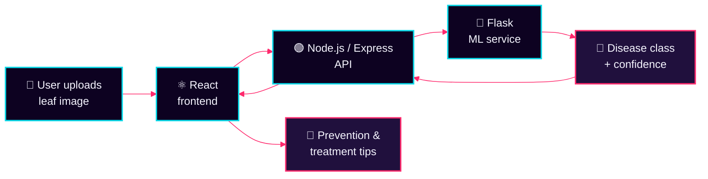

<div align="center">


<br/><br/>

<a href="https://sopanparnate-portfolio.online"></a>
<a href="https://www.linkedin.com/in/sopan-parnate"></a>
<a href="https://github.com/Sopanparnate"></a>
<a href="https://leetcode.com/sopanparnate/"></a>
<a href="mailto:parnatesopan6@gmail.com"></a>

<br/><br/>


</div>


## `ABOUT_ME`

<table>
<tr>
<td width="58%" valign="top">

```yaml
identity:   Sopan Parnate
role:       B.E. Computer Science Engineering Student
core:       [Java, DSA, MERN Stack]
interests:  [Backend, Cybersecurity, Cloud, System Design]
building:   ForensiHash
mission:    Build useful software, learn continuously, improve every commit.
```

I'm a Computer Science Engineering student who enjoys building practical software and understanding how it works under the hood. I use **Java** and **Data Structures & Algorithms** to strengthen my problem-solving foundation, and I build web applications with the **MERN stack**.

I'm especially interested in **backend engineering, REST APIs, cybersecurity, cloud computing and system design**. Right now I'm developing **ForensiHash**, a digital forensics project focused on evidence integrity verification and chain-of-custody management.

</td>
<td width="42%" valign="top">

### `SYSTEM_STATUS`

| Module | Status |
|:--|:--|
| 🔨 **Current build** | ForensiHash |
| 📚 **Learning** | Spring Boot · System Design |
| 🧩 **Practice** | Java + DSA on LeetCode |
| 🎯 **Goal** | Software dev internship & collaboration |
| 🎓 **CGPA** | ~9.0 / 10 |

</td>
</tr>
</table>

<div align="center">

*Build with purpose. Learn continuously. Improve with every commit.*

</div>

## `TECH_STACK`

<div align="center">

<table>
<tr>
<td align="center" width="170"><b>🧠 Languages</b></td>
<td></td>
</tr>
<tr>
<td align="center"><b>🎨 Frontend</b></td>
<td></td>
</tr>
<tr>
<td align="center"><b>⚙️ Backend</b></td>
<td> &nbsp; <code>REST APIs</code> · <code>JWT Auth</code> · <code>Socket.IO</code></td>
</tr>
<tr>
<td align="center"><b>🗄️ Databases</b></td>
<td></td>
</tr>
<tr>
<td align="center"><b>🛠️ Dev tools</b></td>
<td></td>
</tr>
<tr>
<td align="center"><b>🔭 Exploring</b></td>
<td></td>
</tr>
</table>

</div>

## `PROJECT_DATABASE`

<table>
<tr>
<td width="50%" valign="top">

### 🏛️ SchemeSathi


An LLM-powered multilingual chatbot concept that helps citizens explore government schemes and understand eligibility.

- 🔎 Scheme discovery by state, category and income
- 🔐 Authentication with JWT + bcrypt
- 📱 Responsive interface for citizen queries


<a href="YOUR_SCHEMESATHI_REPOSITORY_URL"></a>
<a href="YOUR_SCHEMESATHI_DEMO_URL"></a>

<!-- Add a screenshot at assets/schemesathi.png and uncomment:

-->

</td>
<td width="50%" valign="top">

### ⚔️ CodeZenith


A competitive coding platform built around problem solving, an in-browser code editor and live contest leaderboards.

- ⚡ Real-time leaderboard with Socket.IO
- 🧪 Editor with syntax highlighting and test-case validation
- 🛡️ Role-based access for admins and participants


<a href="YOUR_CODEZENITH_REPOSITORY_URL"></a>
<a href="YOUR_CODEZENITH_DEMO_URL"></a>

<!-- Add a screenshot at assets/codezenith.png and uncomment:

-->

</td>
</tr>
<tr>
<td width="50%" valign="top">

### 🌿 AgriGuard


An AI-assisted crop disease detection system that analyzes leaf images and returns prevention guidance.

- 🐍 Python/Flask ML service connected to a web app
- 📸 Leaf image upload and disease classification
- 💊 Prevention and treatment suggestions


<a href="YOUR_AGRIGUARD_REPOSITORY_URL"></a>
<a href="YOUR_AGRIGUARD_DEMO_URL"></a>

<!-- Add a screenshot at assets/agriguard.png and uncomment:

-->

</td>
<td width="50%" valign="top">

### 🔏 ForensiHash


A configurable digital forensics tool for evidence integrity verification and chain-of-custody management.

- 🧬 Evidence integrity verification
- 📜 Chain-of-custody record management
- 🕵️ Forensic workflow and auditability


<a href="YOUR_FORENSIHASH_REPOSITORY_URL"></a>

<!-- Update the feature list and stack icons above to match the real project.
Add a screenshot at assets/forensihash.png and uncomment:

-->

</td>
</tr>
</table>

<div align="center">

**More projects and case studies →** [sopanparnate-portfolio.online](https://sopanparnate-portfolio.online)

</div>

## `AGRIGUARD_SYSTEM_MAP`



## `DSA_EXECUTION_MODULE`

<table>
<tr>
<td width="60%" valign="top">

I use **Java** to practice data structures and algorithms, with a focus on problem solving, algorithmic efficiency, and time and space complexity.

| Focus | Details |
|:--|:--|
| **Language** | Java |
| **Topics** | DSA · Complexity Analysis · Interview Prep |
| **Coursework** | *Programming in Java with DSA* — NPTEL |
| **Profile** | [leetcode.com/sopanparnate](https://leetcode.com/sopanparnate/) |

</td>
<td width="40%" align="center" valign="middle">

<a href="https://leetcode.com/sopanparnate/">

</a>

</td>
</tr>
</table>

## ` GITHUB_ANALYTICS`

<div align="center">


<br/>


<br/>


<sub>Analytics are provided by third-party services and may occasionally be unavailable.</sub>

</div>

## `CONTRIBUTION_TRACE`

<div align="center">

<picture>
  <source media="(prefers-color-scheme: dark)" srcset="https://raw.githubusercontent.com/Sopanparnate/Sopanparnate/output/github-snake-dark.svg"/>
  <source media="(prefers-color-scheme: light)" srcset="https://raw.githubusercontent.com/Sopanparnate/Sopanparnate/output/github-snake.svg"/>
  
</picture>

</div>

## `EDUCATION_LOG`

| 🎓 Qualification | 🏫 Institute | 📊 Score | 📅 Year |
|:--|:--|:--:|:--:|
| **B.E. Computer Science** | PRMCEAM, Badnera, Maharashtra | **CGPA ~9.0 / 10** | 2023 – Present |
| **HSC (12th)** | Sunrise Dnyanpeeth Jr. College of Science, Sasti | 83.5% | 2023 |
| **SSC (10th)** | Shri Jageshwar School and Junior College, Wadegaon | 71.0% | 2019 |

## `CERTIFICATION_RECORD`

- ☕ **Programming in Java with Data Structures & Algorithms** — NPTEL
- 🌐 **Web Development Certification** — EduSkills
- 🛡️ **Cybersecurity Virtual Internship** — Palo Alto Networks supported
- 📘 Ongoing online courses and technical workshops

## `ESTABLISH_CONNECTION`

```yaml
connection_status: OPEN
interested_in:     [Software development internships, Project collaboration, Technical discussions]
preferred_mode:    Learn together. Build responsibly. Share knowledge.
```

<div align="center">

<a href="https://sopanparnate-portfolio.online"></a>
<a href="https://www.linkedin.com/in/sopan-parnate"></a>
<a href="https://github.com/Sopanparnate"></a>
<a href="https://leetcode.com/sopanparnate/"></a>
<a href="mailto:parnatesopan6@gmail.com"></a>

<br/><br/>

**`> Connection open. Let's build something meaningful.`**


</div>
