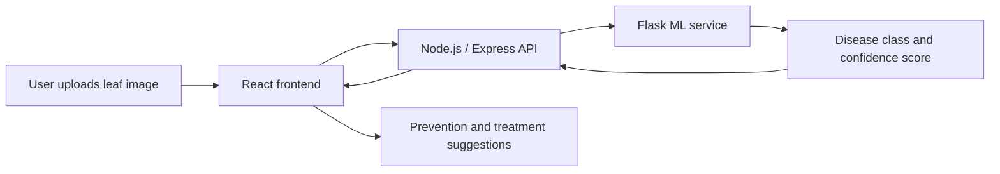

<!-- ============================================================
  GitHub Profile README: Sopan Parnate (@Sopanparnate)
  Theme: dark (#0D1117) · accent cyan (#00D4FF) · secondary purple (#8B5CF6)
  Search for "YOUR_" to find every placeholder you still need to fill in.
============================================================ -->

<!-- ======================= HERO ======================= -->

 

 

<!-- ======================= ABOUT ======================= -->
## About

I'm a Computer Science Engineering student who enjoys building practical software and understanding how it works under the hood. My foundation is **Java and Data Structures & Algorithms**, and I apply it to full-stack web development with the **MERN stack**, designing REST APIs and shipping working products.

I'm especially interested in backend engineering, cybersecurity, cloud computing and system design. I'm currently building **ForensiHash**, a digital forensics project, and I'm looking for **software development internships** and technical collaboration.

| | |
|:--|:--|
| **Education** | B.E. Computer Science, PRMCEAM, Badnera (2023 – Present) · CGPA ~9.0 / 10 |
| **Core strengths** | Java · Data Structures & Algorithms · MERN stack · REST APIs |
| **Interests** | Backend engineering · Cybersecurity · Cloud computing · System design |
| **Looking for** | Software development internship (remote or on-site), available immediately |

<!-- To update: edit the CGPA and availability in the table above. -->

---

## Currently Building and Learning

| | |
|:--|:--|
| **Building** | **ForensiHash**: digital evidence integrity verification and chain-of-custody management |
| **Learning** | Spring Boot · System Design |
| **Practicing** | Java and DSA problems on [LeetCode](https://leetcode.com/sopanparnate/) |

<!-- Update this table whenever your focus changes. -->

---

## Tech Stack

| Category | Technologies |
|:--|:--|
| **Languages** |  |
| **Frontend** |  |
| **Backend** |  &nbsp; REST APIs · JWT authentication · Socket.io |
| **Databases** |  |
| **Developer Tools** |  &nbsp; Render |
| **Currently Exploring** |  |

---

## Featured Projects

<table>
<tr>
<td width="50%" valign="top">

### SchemeSathi
`Completed`

An LLM-powered multilingual chatbot that helps citizens check eligibility for government schemes and get answers to their queries.

- Multi-filter scheme discovery (state, category, income)
- Secure authentication with JWT and bcrypt
- Responsive React interface with real-time filter updates

Repository: `YOUR_SCHEMESATHI_REPOSITORY_URL`
 Live demo: `YOUR_SCHEMESATHI_DEMO_URL`

<!-- Screenshot placeholder: add ./assets/schemesathi.png and embed it here -->

</td>
<td width="50%" valign="top">

### CodeZenith
`Completed`

A competitive coding platform with timed problem-solving, a built-in code editor and live contest leaderboards.

- Real-time leaderboard updates with Socket.io
- Code editor with syntax highlighting and test-case validation
- Role-based access for admins (problem setters) and participants

Repository: `YOUR_CODEZENITH_REPOSITORY_URL`
 Live demo: `YOUR_CODEZENITH_DEMO_URL`

<!-- Screenshot placeholder: add ./assets/codezenith.png and embed it here -->

</td>
</tr>
<tr>
<td width="50%" valign="top">

### AgriGuard
`Completed`

An AI-powered crop disease detection system that identifies diseases from leaf images and suggests prevention steps.

- Python/Flask ML service connected to a MERN frontend via REST API
- Image upload with disease classification and confidence score
- Prevention and treatment suggestions for 10+ crop diseases

Repository: `YOUR_AGRIGUARD_REPOSITORY_URL`
 Live demo: `YOUR_AGRIGUARD_DEMO_URL`

<!-- Screenshot placeholder: add ./assets/agriguard.png and embed it here -->

</td>
<td width="50%" valign="top">

### ForensiHash
`In Progress`

A digital forensics tool focused on evidence integrity verification and chain-of-custody management. Final-year B.E. project.

- Evidence integrity verification
- Chain-of-custody management
- <!-- Add only features you have actually implemented -->`YOUR_FORENSIHASH_FEATURE`

Repository: `YOUR_FORENSIHASH_REPOSITORY_URL`

<!-- Screenshot placeholder: add ./assets/forensihash.png when available -->

</td>
</tr>
</table>

More projects and case studies: **[sopanparnate-portfolio.online](https://sopanparnate-portfolio.online)**

### AgriGuard: System Overview

---

## Problem Solving: Java and DSA

I use **Java** to practice **data structures and algorithms**, focusing on algorithmic thinking, time and space complexity analysis, and coding-interview preparation.

| Focus | Details |
|:--|:--|
| **Language** | Java (core) |
| **Topics** | Data Structures & Algorithms · complexity analysis · interview preparation |
| **Coursework** | Programming in Java with Data Structures & Algorithms (NPTEL) |
| **Profile** | [leetcode.com/sopanparnate](https://leetcode.com/sopanparnate/) |

<!-- Optional: add a LeetCode stats card here only after you verify the service shows your real data. -->

---

## GitHub Analytics

These cards come from third-party services. If one doesn't load, refresh or view my <a href="https://github.com/Sopanparnate">GitHub profile</a> directly.

  

<picture>
  <source media="(prefers-color-scheme: dark)" srcset="https://raw.githubusercontent.com/Sopanparnate/Sopanparnate/output/github-snake-dark.svg"/>
  <source media="(prefers-color-scheme: light)" srcset="https://raw.githubusercontent.com/Sopanparnate/Sopanparnate/output/github-snake.svg"/>
  
</picture>

---

## Education

| Qualification | Institute | Score | Year |
|:--|:--|:--|:--|
| **B.E. Computer Science** | PRMCEAM, Badnera, Maharashtra | CGPA ~9.0 / 10 | 2023 – Present |
| **HSC (12th)** | Sunrise Dnyanpeeth Jr. College of Science, Sasti | 83.5% | 2023 |
| **SSC (10th)** | Shri Jageshwar School and Junior College, Wadegaon | 71.0% | 2019 |

## Certifications and Courses

- **Programming in Java with Data Structures & Algorithms**, NPTEL
- **Web Development Certification**, EduSkills
- **Cybersecurity Virtual Internship**, Palo Alto Networks supported
- Ongoing online courses and technical workshops

---

## Let's Connect

I'm open to **software development internships**, collaboration on interesting projects, and technical discussions. Feel free to reach out.

